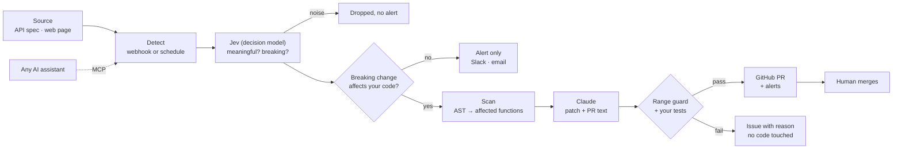

# Driftless

**APIs drift. Your code doesn't.**
A change monitor for the APIs and pages your product depends on — and when an API breaks your code, Claude writes the fix as a PR that your own tests have already verified.

> **The demo in one sentence:** a payments API ships a breaking v2, Driftless catches it, Claude patches the customer's code, the tests go from `FAILED` to `OK`, and a PR is waiting for a human to merge — while Slack/email get the alert and any AI assistant can ask Driftless what changed over MCP.

YC Request for Startups: **Self-Maintaining APIs** · built at c0mpiled-17 Seoul (2026-11-09)

---

## Two kinds of AI, kept apart

The AI that writes a fix should never grade its own work. **Jev** (non-generative decision model, via OpenRouter) judges whether a change matters and whether it breaks integrations. **Claude** (generative) writes the patch and PR only after that. **Your tests** decide whether the PR exists. Same principle we use in production at SemiHub, where Jev checks that published conference dates actually appear in the official source.

## Why this matters

Third-party APIs change all the time: endpoints move, fields get renamed, new parameters become required. Providers announce it in a changelog nobody reads, and customers find out when production breaks. Agentic coding tools proved teams will let a tool touch their repo **if it is careful**. The missing piece is the layer that notices the change, applies it, and *proves* the fix before a human sees it.

## Architecture



## What works today

- [x] **Sources**: API specs (diffed by endpoint and field identity) and web pages (crawled, diffed by line)
- [x] **Detection**: provider webhook, or scheduled checks run one at a time; the first check is the baseline, empty responses never overwrite it
- [x] **AI judge (Jev)**: every detected change is scored by Jev, TypeSafe's non-generative decision model (typed answers with probabilities, no generated text): *meaningful?*, *breaking?*, *kind*. Noise is suppressed. Measured: a volatile counter line → noise (meaningful 0.04, no alert); an endpoint-move notice → breaking (0.97, alert)
- [x] **AI fix**: Claude (via the `claude` CLI) writes the patch and the PR description; rule-based codemod fallback when AI is unavailable
- [x] **Verification**: range guard (edits only inside affected functions) + tests run against the new API before and after the patch
- [x] **Outputs**: PR (local repo branch, or a real GitHub repo when configured), Slack webhook, SMTP email, issue when no safe fix exists
- [x] **MCP server**: AI assistants can ask what changed, add sources, read PRs — merge is never exposed
- [x] **Self-test**: end-to-end and deterministic (`python3 selftest.py`)

## Request lifecycle (API change)

1. Provider publishes spec v2 → webhook hits `/hooks/paylite`
2. Spec diff by stable field identity (`canon`): renamed / removed / new required
3. AST scan maps each change to the functions that call that endpoint with that method
4. Tests on `main` against the live v2 API → **FAILED** (proves the break is real)
5. Claude writes patch + PR text → range guard rejects any edit outside affected functions
6. Tests on the patched copy → **OK** → branch + PR + Slack/email alert
7. A field you read was removed with no replacement → **issue**, no PR

## Run locally in 60 seconds

```bash
git clone https://github.com/RickYoon/driftless && cd driftless
./run.sh                       # or: python3 server.py
open http://127.0.0.1:8790     # landing  ·  /app.html demo  ·  /console.html internals
```

Python 3.10+ and git. Standard library only. Optional: the `claude` CLI (AI-written PRs; otherwise rule-based) and an OpenRouter key in `OPENROUTER_API_KEY` or `~/.config/openrouter/key` (Jev verdicts; otherwise every change alerts).

## Connect Claude (MCP)

```bash
claude mcp add driftless -- python3 /path/to/driftless/mcp_server.py
```

Tools: `driftless_status` · `list_sources` · `add_source` · `check_now` · `recent_changes` · `list_prs` · `list_alerts`. Verified: Claude answered *"what changed in Paylite, what PR was opened, and the test results"* using only these tools.

## Judge demo

1. `./run.sh`, open `/app.html`
2. **Step 1** shows two sources: the Paylite API (webhook) and its changelog page (crawled every 15s)
3. Click **Edit page (demo)** on the changelog → Step 2 shows only the changed line → Step 3 logs the alert
4. Click **▶ Demo: Paylite changes its API** → the checklist runs → a PR tagged **✨ Written by Claude** appears with `before FAILED` / `after OK`
5. Click **Merge pull request** (only a human can)
6. In a terminal, ask Claude through MCP: *"What changed in Paylite and what do the PR's tests say?"*

Deterministic fallback: `python3 selftest.py` runs the same pipeline with AI disabled.

## Tests

```
$ python3 selftest.py
PASS  breaking change -> PR (red -> green) -> merged
PASS  unfixable change -> issue, no PR
PASS  unsubscribed repo -> detected, no action
```

## Repository map

| Path | What |
|---|---|
| `server.py` | Fake provider API, webhook, diff, scan, Claude patch, range guard, tests, PR, sources, scheduler, Slack/email/GitHub |
| `mcp_server.py` | MCP server (stdio) for AI assistants |
| `run.sh` | One-command start |
| `web/index.html` | Landing (KO/EN) |
| `web/app.html` | 3-step demo app (KO/EN) |
| `web/console.html` | Every internal step; play the API provider |
| `customer_template/` | The sample customer repo (`acme-shop`) and its tests |
| `selftest.py` | End-to-end self-test |

## Honest boundary

- Paylite is a **fictional** API and `acme-shop` is a **local** sample repo. Real GitHub PRs need a repo configured in the app and push access.
- One language (Python). Automatic fixes cover renames, moved endpoints, and new required params with a provider-supplied migration default. Anything else becomes an issue by design.
- Only the affected file is sent to Claude. AI output is never trusted directly: the range guard and the tests decide.
- Scheduler and state are in-process for the demo. Production would move detection to scheduled jobs and PRs to the GitHub API.

## Stack

Python standard library (`http.server`, `ast`, `difflib`, `smtplib`, `unittest`) · git · Claude (`claude` CLI) · MCP (stdio JSON-RPC) · plain HTML/CSS/JS.

## The pitch

**Every product runs on someone else's API. Driftless keeps it running when that API changes: one AI judges, another writes, your tests decide.**
